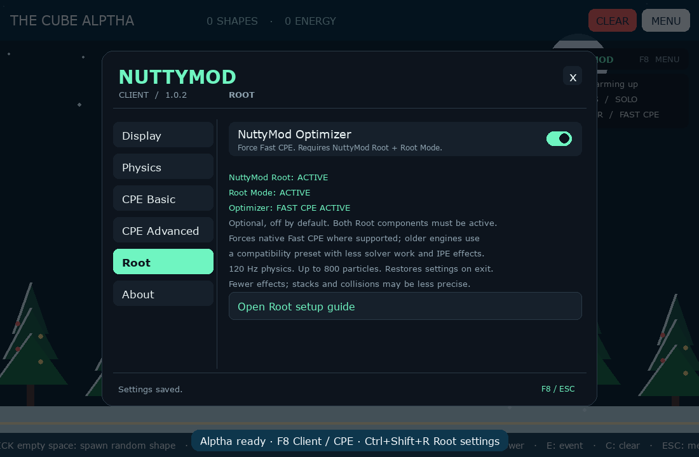

# The Cube Alptha

A separate modded edition of The Cube with NuttyMod Client, CPE settings,
NuttyMod Loader, built-in game-level Root and a live connection screen.

The connection screen starts **Node.js → .NET Aspire → Go**, verifies the
services and a Node-to-Go cache round trip, installs the bundled NuttyMod
packages and Python dependencies, then opens the game. It shows real setup
results and stops with a readable error if a required step fails.

## Start

Download this repository with **Code → Download ZIP**, extract it to a writable
folder, and install **Python 3.14** with Tk support. Python 3.11.8 or newer is
required; 3.14 is the tested version. On Windows, enable Python's PATH option.

- **Windows:** double-click `Launch The Cube Alptha.cmd`.
- **Linux / macOS:** run `sh launch.sh`.
- **Terminal:** `python bootstrap.py --headless`.

First launch requires internet access to restore Aspire and install Python
dependencies. Missing Node.js (20+), Go (1.24+) and .NET SDK (10+) are downloaded
from their official distributions, checksum-checked and extracted locally under
`.runtime/tools`. Setup does not request administrator privileges. Linux needs
the OS SDL libraries and the Python Tk/venv packages. macOS is supported by the
launcher but has not been tested in CI.

The Python environment, downloads and logs stay under `.runtime`. Aspire hosts
the existing dependency-free Node bridge and Go cache on loopback. Ports 4310,
4311, 15271, 21271 and 22271 must be available. Closing the game or cancelling
the connection screen shuts down the launcher's service processes.

## Included versions

| Component | Bundled version |
| --- | --- |
| The Cube Alptha | 0.1.0-alpha.1 |
| Base game | 6.4.3-nightly.2 Christmas |
| NuttyMod Client | 1.0.2 |
| NuttyMod Loader | 1.4.5 stable; upstream includes optional 1.5.0-beta API |
| NuttyMod Root | 1.0.0 |
| Root Mode / library | 1 / 1.2 |
| CPE / CPELoader | 0.0.3-nightly / 2 |
| Aspire AppHost | 9.5.2 |

These are the current available components verified on November 18, 2026.
The newest game source is a **nightly**, not a 6.4.3 stable release. Versions
and immutable upstream references are recorded in [components.lock.json](components.lock.json).
New upstream releases require an explicit edition update; launch does not replace
your modded source with an unchecked latest download.

The original official `NuttyMod-Root-1.0.0-Packages.zip` is bundled unchanged.
Its SHA-256 matches the asset from [CPE Flasher Tool v1.2.5](https://github.com/nuttyinc578/CPE-flashing-tool/releases/tag/v1.2.5).
All three TARs are installed from that matching set:

- `nuttymod_root.tar`
- `rootmode.tar`
- `nuttymod_cube_verifycation.tar` (official filename)

The installer checks the ZIP, all internal package hashes, client manifest and
Root Mode inventory before loading code. Repeat setup preserves your preferences
and refuses to silently overwrite changed package files.

## Controls and settings

- **F8:** NuttyMod Client, HUD, CPE Basic, CPE Advanced and optimizer.
- **Ctrl+Shift+R** or **Settings:** NuttyMod Root settings, including your custom
  window title, theme, gravity, sound and CPE connection settings.
- **Ctrl+A:** existing CPELoader controls.



Root Mode and NuttyMod Root are enabled for this edition. They customize the
game and provide confined userdata access; they do not root your operating
system. The optimizer remains off until you enable it in F8 → Root. CPELoader
keeps its unlocked/integrity warning and pauses at 50% for **Enter**. The official
game updater remains blocked for this unlocked build.

Player settings are in `game/userdata/` and `game/settings.json`. This edition
does not modify another Cube installation. Back up your userdata before replacing
or updating the Alptha folder.

## Troubleshooting and verification

Connection and setup failures appear on screen. Detailed build/game output is
in `.runtime/logs/`. If a port is occupied, close the other CPE/Aspire session.
Keep the complete extracted folder together. Use a fresh extracted copy if you
have edited a bundled package and want to restore it.

```sh
python -m pip install --only-binary=:all: -r requirements.txt
python -m unittest discover -s tests -p 'test_*.py' -v
python tests/smoke_game.py
python bootstrap.py --headless --connection-test
```

`--install-only` verifies and installs the bundled packages without connecting.
The smoke test runs 12 real game frames with real Root packages, tests the CPE
optimizer, checks the title and writes screenshots and a JSON report. GitHub
Actions also tests the live Aspire/Node/Go connection and service shutdown on
Windows and Linux. See [verification notes](docs/VERIFICATION.md).

## Source and licenses

The base game is vendored from [nuttyinc578/the-cube](https://github.com/nuttyinc578/the-cube)
at the commit in the lock file. NuttyMod Client comes from
[its official repository](https://github.com/nuttyinc578/nuttymod-client-for-the-cube-beta).
NuttyMod Loader is the latest readable stable loader bundled with the upstream
game; the standalone loader repository does not currently publish a newer release.
The original licenses remain in `game/`, `licenses/` and the root [LICENSE](LICENSE).
Music attribution is preserved in `game/THIRD_PARTY_NOTICES.txt`.

The AppHost follows [Aspire's configuration documentation](https://aspire.dev/app-host/configuration/)
and binds development services to localhost. This project includes source and
verified mod archives; it does not yet provide a standalone Windows EXE installer.
